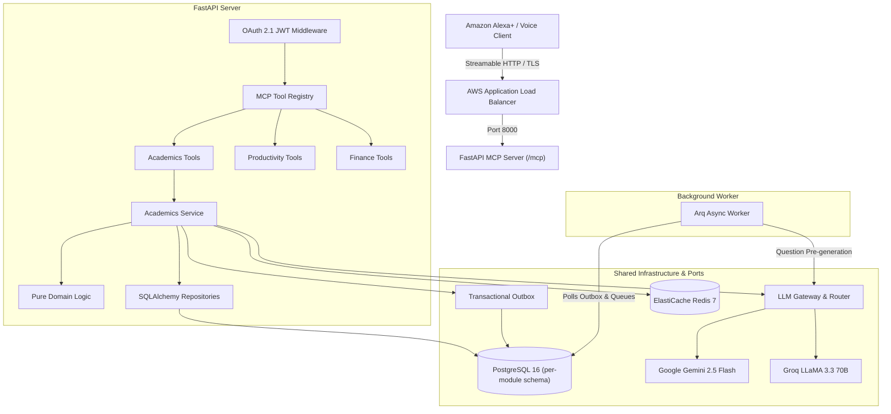

# Sahayak Architecture & System Design

This document details the architectural principles, layering constraints, data boundaries, and voice UX requirements of the Sahayak platform.

---

## 1. High-Level System Architecture



---

## 2. Layering & Dependency Rules

1. **Dependency Direction:**
   $$\text{Tools} \longrightarrow \text{Services} \longrightarrow \text{Domain}$$
   Adapters implement inward-facing ports.
2. **Domain Purity:**
   Domain code contains zero I/O, zero network calls, and imports no external frameworks (no FastAPI, no SQLAlchemy, no MCP SDK).
3. **Module Boundaries:**
   Modules are strictly independent. Cross-module imports are prohibited by `import-linter`. Inter-module communication flows exclusively through:
   - Module `api.py` protocols.
   - Transactional domain events published to `core.outbox_events`.
4. **Core Independence:**
   `sahayak.core` never imports from `sahayak.modules`.

---

## 3. Data & Storage Boundaries

- **Single Database, Per-Module Schemas:** Each module owns an isolated PostgreSQL schema (`core`, `academics`, `productivity`, etc.) and an independent Alembic migration branch.
- **No Cross-Schema Foreign Keys or Joins:** Tables in `academics` do not foreign-key into `productivity`.
- **Row-Level Tenancy:** All user records are indexed and queried strictly by the verified `user_id` principal.

---

## 4. Voice Interaction & Response Envelopes

Every tool invocation returns a standardized JSON response envelope:
```json
{
  "ok": true,
  "spoken_summary": "You're on a 5-day study streak! You've answered 42 questions with 81% accuracy.",
  "data": { ... },
  "next_actions": [ ... ],
  "meta": { "request_id": "...", "duration_ms": 42.1 }
}
```

Voice constraints strictly enforced:
- `spoken_summary` $\le 300$ characters.
- Zero markdown formatting (`**`, `##`) and zero raw URLs.
- Numerical values read naturally in spoken form.
- Correct answers concealed during question delivery.
